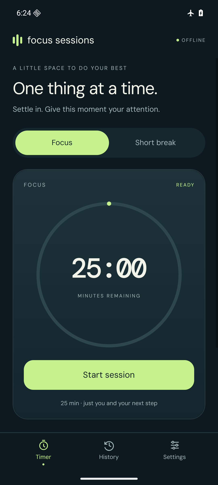
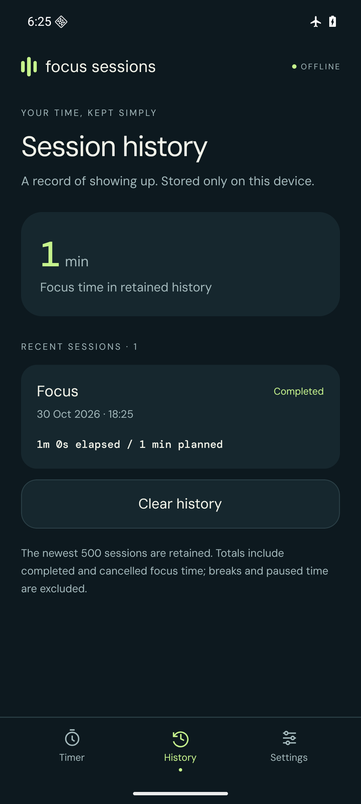
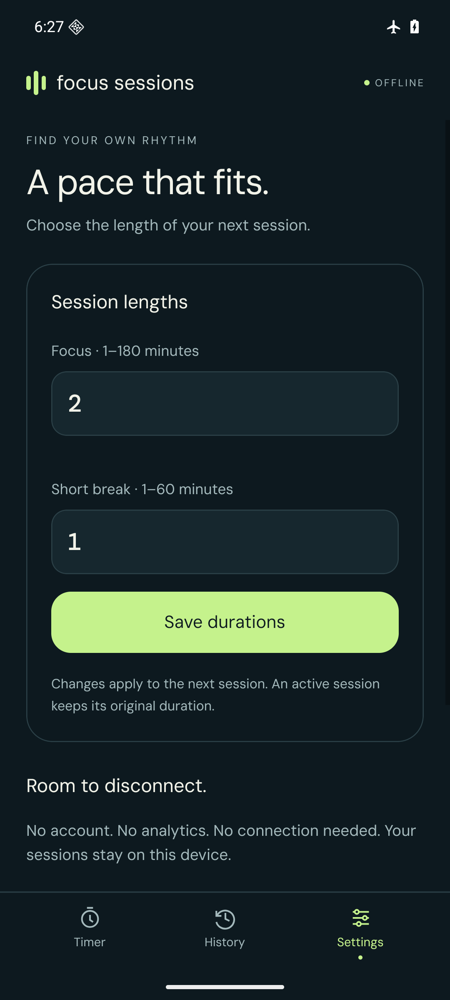

# Focus Sessions

A little space for one thing at a time. An offline Android focus timer with pause, short breaks, and a durable local history. No account, connection, or background service.

  
  
  

## Install

Download [focus-sessions-1.0.0.apk](demo/focus-sessions-1.0.0.apk), open it on your Android phone, allow installation from that source when Android asks, and launch **Focus Sessions**. Installation permissions can be turned off afterward. No development tools are needed to use the APK. Uninstalling deletes local sessions; Android backup is disabled.

The APK bundles JavaScript, fonts and native libraries. Android 7/API 24 or newer is the build minimum; included ABIs are ARM64 and x86-64. Actual validation targets and checksum are in [demo/README.md](demo/README.md). Physical phones and iOS have not been validated.

## A first session

1. Open **Settings**, choose focus and short-break minutes, and save.
2. Open **Timer**, select **Focus** or **Short break**, and start.
3. Pause when you need to step away; resume when ready. Paused time is excluded.
4. After completion, open **History** to see the planned and actual time.

For a quick demonstration, choose one minute, start, pause, resume, and let it finish. History starts empty; the app does not seed achievements or sample sessions. Mode changes during an active session require confirmation and record the old session as cancelled. Saved duration changes apply only to the next session. Cancellation and history deletion also ask for confirmation.

## Dependable, with clear limits

The timer derives elapsed time from timestamps, not callback counts. Leaving or closing the app does not pause a running session. Reopening reconciles its logical finish time exactly once. **There is no background alarm or sound.**

Sessions and preferences live in local SQLite transactions. The newest 500 history records and 2,000 transition events are retained. The focus total includes elapsed time from retained completed and cancelled focus sessions; it excludes pauses and breaks. Clear history leaves an active timer and preferences intact. The app exposes failed writes and offers reload rather than pretending a save succeeded. Unreadable timer data can be repaired separately from valid history.

A monotonic clock ignores device wall-clock adjustments within one process. After a process/device restart, recovery uses the saved wall time: a forward jump can finish a session; a backward jump adds no elapsed time and reanchors it. Keep automatic device time enabled. This release does not provide a trusted clock across restarts or guarantee execution while closed.

See [architecture](docs/ARCHITECTURE.md), [development](docs/DEVELOPMENT.md), [verification](docs/VERIFICATION.md), and [third-party notices](THIRD_PARTY_NOTICES.md).
